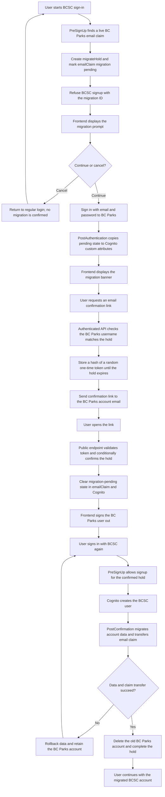

# Migrating from a BC Parks Account to BCSC

## Security and lifecycle

- The email claim remains owned by the BC Parks account until the BCSC account
  data migration succeeds. `migrateHoldPending` only controls the source
  account's banner; it does not transfer the claim.
- Requesting the email requires the custom API authorizer and verifies that
  the authenticated username matches `oldParksUsername` on the hold.
- The confirmation route is public because the emailed token is its bearer
  credential. Only the SHA-256 token hash is stored. The token is random,
  single-use, conditionally checked against the pending hold, and expires with
  the hold.
- After email confirmation, the BC Parks account is signed out. The user must
  sign in with BCSC to create the BCSC account and start migration.
- The migration runs during the new user's initial
  `PostConfirmation_ConfirmSignUp`, not on subsequent
  `PostAuthentication_Authentication` events.
- If data migration fails, transferred records are rolled back, the hold is
  returned to `confirmed`, and the new BCSC user is deleted. This allows
  another BCSC sign-in attempt while preserving the old BC Parks account and
  email claim.
- If email-claim transfer fails after data migration succeeds, the handler
  does not delete the old account or mark the hold complete. This is a
  post-migration recovery case distinct from a failed data transfer.
