# Migrating from BC Parks Account to BCSC

```mermaid
flowchart TD
  A[User signs up for a BC Parks account] --> B[PreSignUp validates the signup]
  B --> C[Email claim written<br/>owner = BC Parks Cognito username<br/>source = bcparks]
  C --> D[Cognito creates and confirms BC Parks account]

  D --> E[Later, user chooses Sign in with BCSC]
  E --> F[BCSC authenticates user and returns email]
  F --> G[PreSignUp ExternalProvider checks canonical email claim]
  G --> H{Does a live BC Parks account own the claim?}
  H -- No --> I[Normal BCSC signup continues]
  I --> J[Cognito creates BCSC user]
  J --> K[PostAuthentication runs]
  K --> L[No confirmed migration hold<br/>return without migration]

  H -- Yes --> M[Create migrateHold<br/>status = pending<br/>oldParksSub = current claim owner<br/>newBcscUsername = BCSC username<br/>globalId = migrationId]
  M --> N[Refuse initial BCSC signup]
  N --> O[Cognito does not create BCSC user yet]
  O --> P[Amplify reports signup refusal with migrationId]
  P --> R[Frontend navigates to /migrate<br/>stores migrationId in navigation state]
  R --> S[User reviews transfer and chooses Confirm]
  S --> T[Frontend sends PUT /migrate/migrationId]
  T --> U[API loads hold by globalId<br/>validates status and expiry]
  U --> V{Hold is pending and valid?}
  V -- No --> W[Return an error<br/>user may need to restart BCSC sign-in]
  V -- Yes --> X[Conditional transaction sets status = confirmed]
  X --> Y[Frontend immediately starts BCSC sign-in again]
  Y --> Z[BCSC authenticates and PreSignUp runs again]
  Z --> AA{Is the hold confirmed and unexpired?}
  AA -- No --> AB[Refuse signup or create a fresh migration prompt]
  AA -- Yes --> AC[Allow federated signup to continue]
  AC --> AD[Cognito creates the BCSC user]
  AD --> AE[PostAuthentication runs]
  AE --> AF[PostAuthentication loads migrateHold]
  AF --> AG[Conditional lease changes hold<br/>to processing]
  AG --> AH[Migrate records from oldParksSub to new BCSC sub]
  AI --> AJ[Migration helper rolls back transferred records]
  AH --> AI{Data migration succeeds?}
  AI -- No --> AJ
  AJ --> AK[Restore hold to confirmed]
  AK --> AL[Delete new BCSC Cognito user]
  AL --> AM[Keep old BC Parks Cognito user and email claim]
  AM --> Y
  AI -- Yes --> AN[Conditionally transfer email claim<br/>owner = BCSC username<br/>source = bcsc]
  AN --> AO{Claim transfer succeeds?}
  AO -- No --> AP[Do not delete old user or mark hold complete<br/>surface PostAuthentication failure]
  AO -- Yes --> AQ[Delete old BC Parks Cognito user]
  AQ --> AR[Mark migrateHold completed]
  AR --> AS[Return from PostAuthentication]
  AS --> AT[BCSC sign-in completes]
  AT --> AU[User continues with migrated account]

  S -- Cancel --> AV[Return to login<br/>no claim or hold change]
  AV --> E

  classDef success fill:#e7f5e8,stroke:#27823b,color:#111;
  classDef warning fill:#fff4d6,stroke:#ba8500,color:#111;
  classDef failure fill:#fde8e7,stroke:#bb2d25,color:#111;
  classDef store fill:#e8f0fe,stroke:#3b68b2,color:#111;
  class C,M,X,AN,AR store;
  class AU,AT success;
  class W,AB,AP warning;
  class AL,AM,AJ failure;
```

---

- The email claim remains owned by the BC Parks account while the migration is
  pending or confirmed. It is changed only after the account data migration
  succeeds.
- Confirming at `/migrate` does not itself create the BCSC Cognito user. It
  confirms the hold and starts another BCSC sign-in; that signup is admitted
  by PreSignUp and creates the user.
- The migration runs during the new user's initial
  `PostConfirmation_ConfirmSignUp` trigger, not on subsequent
  `PostAuthentication_Authentication` events.
- If data migration fails, migrated data is rolled back, the hold is returned
  to `confirmed`, and the new BCSC user is deleted. This allows another BCSC
  sign-in attempt while preserving the old BC Parks account and email claim.
- The `/migrate/{migrationId}` API is unauthenticated. It validates the UUID,
  hold state, and expiry, then conditionally changes `pending` to `confirmed`
  in a DynamoDB transaction. Repeating an already-confirmed request is safe.
- A pending hold expires after its migration window; a later BCSC attempt can
  start the prompt flow again.
- If email-claim transfer fails after the data migration succeeds, the handler
  does not delete the old account or mark the hold complete. This is a
  post-migration recovery case distinct from a failed data transfer.
